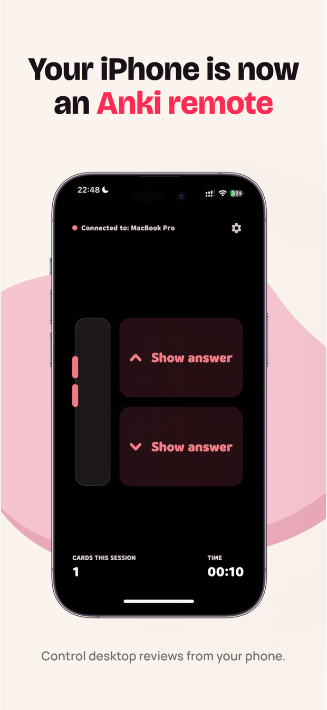
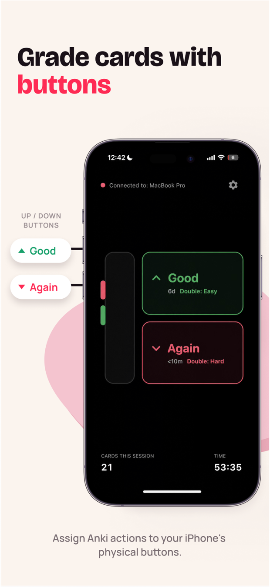
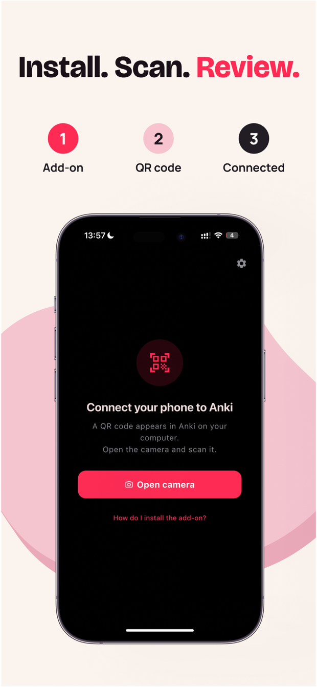
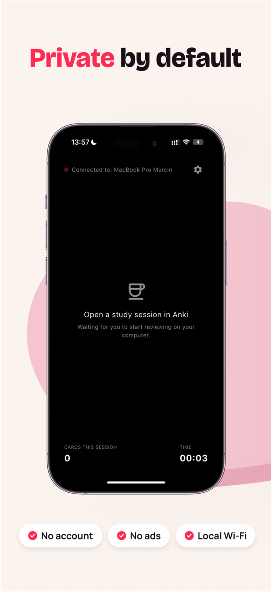

# Oli for Anki

An iPhone remote for Anki Desktop. Reveal answers and grade flashcards with your phone's volume buttons, without reaching for the keyboard.

[Available on the App Store](https://apps.apple.com/us/app/oli-for-anki/id6775209904). Free, with no account or ads.

<table>
  <tr>
    <td><a href="assets/app-store-01.png"></a></td>
    <td><a href="assets/app-store-02.png"></a></td>
  </tr>
</table>

## Why I built it

I made Oli for my girlfriend, who uses Anki to study. The idea was simple: she should be able to keep using Anki on her computer without sitting at the keyboard for every review.

I wanted the phone to work like a small remote. Press a volume button to reveal the answer, then press again to grade the card. Her decks, add-ons and review schedule would stay in desktop Anki.

I built and released the first version in May 2026, then made it available on the App Store for other Anki users.

## Using it

There are two parts: the iPhone app and a Python add-on running inside Anki Desktop. Install the add-on, open its pairing window and scan the QR code with the app. Both devices need to be on the same local network.

<table>
  <tr>
    <td><a href="assets/app-store-03.png"></a></td>
    <td><a href="assets/app-store-04.png"></a></td>
  </tr>
</table>

Once a review is open on the computer, the phone follows its state. You can reveal the answer, choose Again, Hard, Good or Easy, and undo a rating. The app supports on-screen controls as well as volume-button controls, with configurable single- and double-press actions.

The interface has a minimal HUD mode and a more traditional button layout. Session time, card count and haptic feedback help you keep reviewing without repeatedly looking down at the phone.

## How the connection works

The phone talks directly to the add-on over the local network. There is no relay server or cloud database in between.

```text
iPhone app  -- review commands (HTTP) -->  Anki add-on
iPhone app  <-- state updates (SSE) -----  Anki add-on
                                             |
                                      Anki review session
```

Anki remains responsible for the cards, scheduling and review history. The app sends commands such as reveal, grade and undo. The add-on sends back the current review state through a Server-Sent Events connection, so the phone can update when the session changes on the computer.

Pairing passes the connection details and an authentication token to the phone. The iOS app stores that token in Keychain and remembers the paired computer for later sessions.

*These four images are from the published App Store listing.*

## A few implementation details

**A delayed command must not grade the next card.** A rating includes the card ID and a state sequence number. The add-on checks both against the current session before accepting it. If the card or state has changed, it rejects the command rather than applying it to whatever is now on screen.

**Anki has its own UI thread.** Network requests arrive on worker threads, but operations that touch Anki run through a bridge to its Qt main thread. This keeps the networking code separate from direct reviewer operations.

**Volume buttons need native iOS code.** Flutter handles the interface and connection, while Swift handles volume changes through AVAudioSession and MPVolumeView. Those events are passed to Flutter through an event channel and mapped to review actions while the app is in the foreground.

**Connections get interrupted.** The app reconnects to the state stream after connection failures and handles returning to the foreground. Its diagnostics distinguish an expired pairing token from an unreachable computer or a blocked local connection.

Keeping the connection local also has a limitation: some university and public Wi-Fi networks prevent devices from talking to each other. A personal hotspot is the fallback. The app does not control Anki remotely over the internet.

## Built with

- **Flutter and Dart** for the iPhone interface, review controls and connection lifecycle.
- **Python** for the Anki Desktop add-on, local HTTP server and review-state updates.
- **Swift** for native QR scanning, volume-button events and Keychain storage.
- **HTTP and Server-Sent Events** for commands and state synchronization between the devices.

## Status and source

Oli is published on the [App Store](https://apps.apple.com/us/app/oli-for-anki/id6775209904). This repository is a project showcase; the application source remains private.

Oli for Anki is an independent project and is not affiliated with Anki or its developers.
